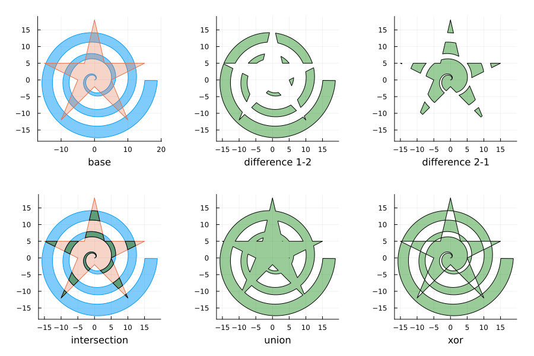
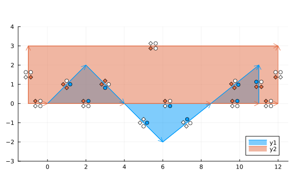
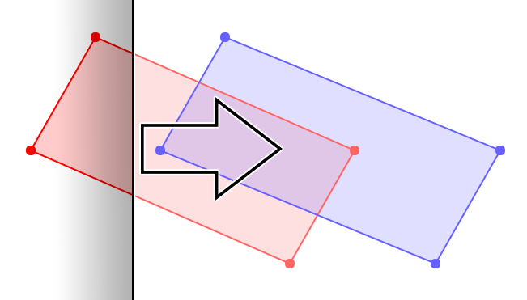
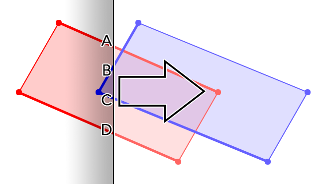
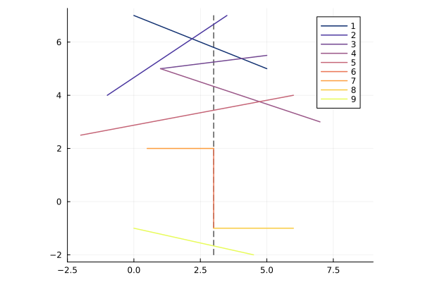
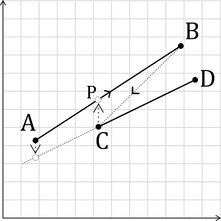
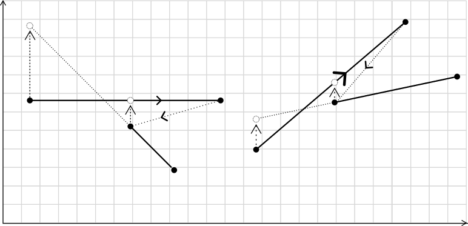
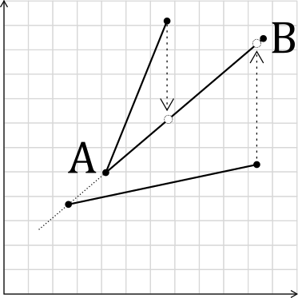
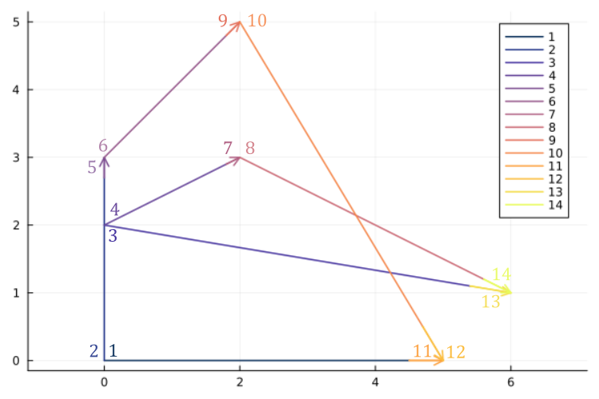

_The Martinez-Rueda algorithm computes boolean operations between polygons. It can be used for polygon intersections (polygon clipping), unions, differences and XORs. I recently implemented it by following a comprehensive guide at https://sean.fun/a/polygon-clipping-pt2/. However, it was slightly lacking in some complex scenarios, mainly resulting from the strict ordering required by the Bentley-Ottmann line intersection algorithm. This post explains my minor modifications to address this crucial part of the algorithm._

Update 2026-10-24: Added the alternative interpretation of clockwise/counter-clockwise for `is_above` and removed the fallback for a vertical line.

[PolygonAlgorithms.jl]: https://github.com/LiorSinai/PolygonAlgorithms.jl
[polygon_clipping]: https://en.wikipedia.org/wiki/Clipping_(computer_graphics)
[martinez_rueda_paper]: https://www.researchgate.net/publication/220163820_A_new_algorithm_for_computing_Boolean_operations_on_polygons
[martinez_rueda_sean]: https://sean.fun/a/polygon-clipping-pt2/
[weiler_atherton]: {{ "mathematics/2023/09/30/polygon-clipping" | relative_url }}
[bentley-ottmann]: https://en.wikipedia.org/wiki/Bentley%E2%80%93Ottmann_algorithm

### Table of Contents

<nav id="toc"></nav>

<h2 id="introduction">1 Introduction</h2>

<figure class="post-figure" id="fig-spiral-star">

<figcaption>Boolean operations between a spiral and a star, computed with the Martinez-Rueda algorithm.</figcaption>
</figure>

I recently updated my [PolygonAlgorithms.jl][PolygonAlgorithms.jl] package to use the Martinez-Rueda algorithm for boolean operations between polygons.
I had originally implemented a version of the Weiler-Atherton algorithm, explained in detail in an earlier [blog post][weiler_atherton].
However, that algorithm can only calculate intersections between polygons, whereas Martinez-Rueda simultaneously calculates 
the intersection as well as unions, differences and XORs between the polygons.
See the above example and the table below for a brief comparison between the algorithms.

<table>
<thead>
  <tr>
    <th></th>
    <th>Martinez-Rueda</th>
    <th>Weiler-Atherton</th>
  </tr>
</thead>
<tbody>
  <tr>
    <td>Operation</td>
    <td>Segment level. Compare fill annotations.</td>
    <td>Point level. Walk along loops.</td>
  </tr>
  <tr>
    <td>Polygon types</td>
    <td>Convex, concave, self-intersecting, holes.</td>
    <td>Convex, concave. Can be extended to holes.</td>
  </tr>
  <tr>
    <td>Time complexity</td>
    <td>$\mathcal{O}((n+m+k)\log(n+m))$</td>
    <td>$\mathcal{O}(nm)$</td>
  </tr>
  <tr>
    <td>Return types</td>
    <td>Segments and regions.</td>
    <td>Points, segments and regions.</td>
  </tr>
</tbody>
</table>

The Martinez-Rueda algorithm is more versatile because it fundamentally operates at a segment level whereas Weiler-Atherton operates at a point level, and so it has a "bigger picture" view of the polygons.
A disadvantage of the Martinez-Rueda algorithm is that it is more sensitive to numerical inaccuracies - for reasons that will be described shortly - such as a line that is almost vertical or tiny regions of intersection. In practice I found their runtimes similar, with Martinez-Rueda running faster in some situations and slower in others. For the spiral-star example, it is about 1.5&times; slower.

The original paper can be found [here][martinez_rueda_paper], but I followed the guide at [https://sean.fun/a/polygon-clipping-pt2/](https://sean.fun/a/polygon-clipping-pt2/).

<figure class="post-figure" id="fig-fill-annotations">

<figcaption>Fill annotations in the Martinez-Rueda algorithm.</figcaption>
</figure>

The core idea behind the Martinez-Rueda algorithm is to calculate fill annotations for each segment for each polygon: is this segment filled above and below by this polygon, and is it filled above and below by the other polygon?
Once these are known, it is easy to select the relevant segments to the given operation, and to link them up again into polygons.

<figure class="post-figure" id="fig-sweep">
	

		

			
		

		

			
		

    

<figcaption>Line sweep and line stack in the Martinez-Rueda algorithm. Source: <a href="https://sean.fun/a/polygon-clipping-pt2/">sean.fun/a/polygon-clipping-pt2</a>.</figcaption>
</figure>

The genius of the Martinez-Rueda algorithm is to extend upon the [Bentley-Ottmann algorithm][bentley-ottmann] for segment intersections to do this.
It does a vertical line sweep from left to right, bottom to top.
At any given moment, we can imagine having a stack of all the lines that intersect the vertical line, ordered from top to bottom.
According to the Bentley-Ottmann algorithm, to find intersections through a segment, we only need to check for intersections with the segments immediately above and immediately below it in the stack.
At the same time, we can propagate the fill annotations from the segment below, or empty space if nothing is below it.
Hence, finding the exact segments that are above and below a segment is paramount to this algorithm, and 
even slight mistakes can cause errors that propagate to other segments.

This is the gist of the algorithm.
The practicalities of handling the event queue and many edge cases such as handling coincident lines and tricky annotation situations are described in the [article][martinez_rueda_sean].
From now on, I will focus only on the `is_above?` algorithm to determine if a segment is above another segment.
I spent a long time debugging the whole Martinez-Rueda algorithm against a variety of test cases, and I always seemed to land back at this `is_above?` function. Getting this function right solved most of my problems.

<h2 id="is-above">2 Is above?</h2>

[statusCompare]: https://sean.fun/a/polygon-clipping-pt2/#finding-the-status-transition

For reference, the function is called [statusCompare][statusCompare] in the article.

The goal of this algorithm is to sort lines by height.
This will then give a sweep status like:

<figure class="post-figure" id="fig-sweep-status">

<figcaption>Lines sorted by height.</figcaption>
</figure>

Given line segments $AB$ and $CD$, it is tempting to sort them only by the starting point coordinate:

$$
  A_y > C_y
\tag{2.1}
\label{eq:greater}
$$

This will work in most cases.
However already in the figure we can see an example where it does not.
Line 2's starting point is below line 3's, but it makes more sense to consider line 2 as "above" line 3.

A better definition for "above" is needed.
Instead, define a segment above another if the projection of the other segment's starting point
on this segment lies above that starting point.
That is, the other segment has to project up on to this segment.
Equivalently, the starting point of the other segment lies clockwise to this segment.

<figure class="post-figure" id="fig-project">

<figcaption></figcaption>
</figure>

Using the projection we have $P_y > C_y $, where $P_y$ is:

$$
\begin{align}
  P_y = \frac{B_y - A_y}{B_x - A_x}(C_x - A_x) + A_y  &> C_y \\
\implies  (B_y - A_y)(C_x - A_x) - (C_y - A_y)(B_x - A_x) &> 0
\end{align}
\tag{2.2}
\label{eq:projection}
$$

This is equivalent to checking if the orientation of A-B-C is clockwise:

$$
\begin{align}
  \text{cross}((B-A), (C-B)) &< 0 \\
\implies (B_y - A_y)(C_x - B_x) - (C_y - B_y)(B_x - A_x) &> 0 \\
         (B_y - A_y)(C_x - A_x + A_x - B_x ) - (C_y - A_y + A_y - B_y )(B_x - A_x) &> 0 \\
\implies  (B_y - A_y)(C_x - A_x) - (C_y - A_y)(B_x - A_x) &> 0
\end{align}
\tag{2.3}
\label{eq:cross}
$$

<figure class="post-figure" id="fig-symmetry">

<figcaption></figcaption>
</figure>

However one problem is this equation is not symmetrical.
In the figure above, both projections are above the other line.
Hence `is_above` will return true for both segments. Yet one must be above the other.
Therefore to maintain symmetry, the segment of interest must always be the left segment.
If the first segment is instead to the right, change the criteria to match the second (left) segment's perspective:
  1. The (right) segment is above if its own starting point lies above the left segment. That is, it must project downwards on to the left segment.
  2. Equivalently, the orientation of the starting point of the (right) segment is counter-clockwise to the left segment.

For both cases in the above [figure](#fig-symmetry) the right segment will return false.

If the starting point is colinear or coincident with the other, use the endpoint instead:

<figure class="post-figure" id="fig-coincident">

<figcaption></figcaption>
</figure>

In summary, the `is_above` algorithm is:

<blockquote>
<u><b>Is segment AB above CD?</b></u>  
inputs: $AB$, $CD$  
<b>if</b> $ C_x > A_x $  
$\quad \theta$ $\leftarrow$ orientation($A, B, C$)  
$\quad$ <b>if</b> $\theta$ = colinear  
$\quad\quad \theta \leftarrow$ orientation($A, B, D$)  
$\quad$ <b>return</b> $\theta$ = clockwise  
<b>else</b>  
$\quad \theta \leftarrow$ orientation($C, D, A$)  
$\quad$ <b>if</b> $\theta$ = colinear  
$\quad\quad \theta \leftarrow$ orientation($C, D, B$)  
$\quad$ <b>return</b> $\theta$ = counter-clockwise  
</blockquote>

where `orientation` is:
<blockquote>
<u><b>orientation</b></u>  
inputs: $p, q, r$  
$ c \leftarrow (q_y - p_y)(r_x - q_x) - (r_y-q_y)(q_x-p_x) $  
<b>if</b> $c = 0$  
$\quad$ <b>return</b> colinear  
<b>else if</b> $c > 0$  
$\quad$ <b>return</b> clockwise  
<b>else </b>  
$\quad$ <b>return</b> counter-clockwise  
</blockquote>

This final algorithm is simple, but absolutely crucial for the Martinez-Rueda sweep.

Lastly, it's worth noting how this behaves for a vertical line AB.
In this case from equation $\ref{eq:cross}$ with $A_x=B_x$ we have:

$$
\begin{align}
  (B_y - A_y)(C_x - A_x) &> 0
\end{align}
\tag{2.4}
\label{eq:vertical}
$$

For Martinez-Rueda points are ordered left to right, bottom to top.
So $B_y > A_y$, and this effectively tests that point C is to the right of the line.
If $C_x \le A_x$ (including C on the line), the right branch is used instead, with CD as the reference segment

<h2 id="compare-events">3 Compare events</h2>

[eventCompare]: https://sean.fun/a/polygon-clipping-pt2/#initializing-events

For reference, the function is called [eventCompare][eventCompare] in the article.

It sorts segment events from left to right, bottom to top.
There are two events per segment: a start event and an end event.
An example ordering is:

<figure class="post-figure" id="fig-events">

<figcaption></figcaption>
</figure>

The algorithm is:
1. If the points are not the same, the smaller event is to the left, or the lower one if they are on a vertical line.
2. If the other points are also the same, this event is not smaller. (Equal segments.)
3. If one is a start event and the other an end event, the end event is considered smaller. (Common points.)
4. The smaller event is below the other one according to `not is_above`, unless the segment of interest is vertical, then the smaller event is "not above" if it is to the right.  (Common start/end points.)

For example, in the picture:
- Event 1 is smaller than event 2 by step 4: lower event is to right of a vertical segment.
- Event 2 is smaller than event 5 by step 1: they are on the same segment, but event 2 is defined by the lower start point.
- Event 3 is smaller than event 4 by step 4: common start point but segment 3 is lower than segment 4.
- Event 5 is smaller than event 6 by step 3: same point but event 5 is an end event, while event 6 is a start event.

And so on.

<h2 id="conclusion">4 Conclusion</h2>

This was a short post to address minor issues and some improvements to two parts of the Martinez-Rueda implementation from 
[https://sean.fun/a/polygon-clipping-pt2/](https://sean.fun/a/polygon-clipping-pt2/).
Otherwise that article did a very good job at explaining this algorithm and I highly recommend it.

---
