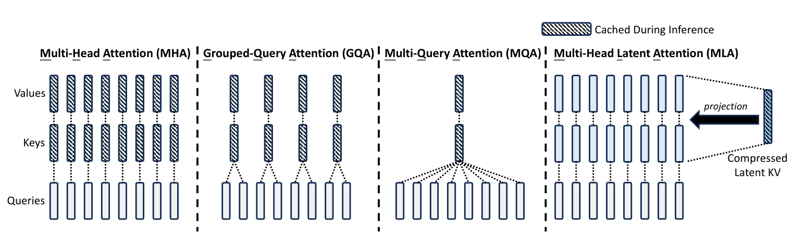

_A deep dive into DeepSeek's Multi-Head Latent Attention, including the mathematics and implementation details. The layer is recreated in Julia using Flux.jl._ 

Update 2026-11-08: This is a major update which reworks the code and explanations. Previously I had missed that MLA's speed up only applies during training, and that during inference it is much slower than standard multi-head attention. Following on from this, I was too dismissive of absorbed attention, which is required to avoid that slow down during inference. This version now has a fuller treatment of absorbed attention, including faster ways to calculate it. 

See also previous posts on transformers:
- [Transformers from first principles in Julia][firstPrinciples].
- [Generative transformer from first principles in Julia][generator].

[firstPrinciples]: {{ "machine-learning/2022/05/18/transformers" | relative_url }}
[generator]: {{ "machine-learning/2024/03/23/transformers-gpt" | relative_url }}
[TransformersLite.jl]: https://github.com/LiorSinai/TransformersLite.jl

All code available at [github.com/LiorSinai/TransformersLite.jl/tree/feature/mla](https://github.com/LiorSinai/TransformersLite.jl/tree/feature/mla).

### Table of Contents

<nav id="toc"></nav>

<h2 id="introduction">1 Introduction</h2>

[deepseek_cnn]: https://edition.cnn.com/2025/01/27/tech/deepseek-ai-explainer/index.html
[deepseek_hackernews]: https://hn.algolia.com/?q=deepseek
[deepseek_tech]: https://www.technologyreview.com/2025/01/31/1110740/how-deepseek-ripped-up-the-ai-playbook-and-why-everyones-going-to-follow-it/

In January 2025, [DeepSeek](https://www.deepseek.com/) unveiled their new DeepSeek-V3 and DeepSeek R1 models.
It took the [world][deepseek_cnn] [by][deepseek_tech] [storm][deepseek_hackernews].
Users were impressed with its abilities on top of their claims that it was up to 50&times; more efficient to train and run than their competitors.

[DeepSeek_R1]: https://github.com/deepseek-ai/DeepSeek-R1
[DeepSeek_V2]: https://github.com/deepseek-ai/DeepSeek-V2
[DeepSeek_V3]: https://github.com/deepseek-ai/DeepSeek-V3

They also released multiple papers 
([DeepSeek-V2][DeepSeek_V2], [DeepSeek-V3][DeepSeek_V3], [DeepSeek-R1][DeepSeek_R1])
with an impressive array of new techniques across the whole machine learning pipeline, from high level theory to intricate implementation details.
Most of it built on existing ideas in innovative ways. They include:
- Theory
    - Multi-Head Latent Attention (MLA): compress vectors during attention, which reduces the cache size during inference.
    - DeepSeekMoE: segmented and isolated mixture of experts. 
    - Multi-token prediction.
    - Reinforcement learning with Group Relative Policy Optimization but without supervised data. 
    - Improved chain-of-thought reasoning.
- Implementation
    - DualPipe: accelerate training by overlapping forward and backward computation and communication phases.
    - Exponential moving average on the CPU.
    - Mixed precision floating point numbers during training. FP8 and FP32 are used.
    - Low-precision storage and communication.

[Attention_2017]: https://arxiv.org/abs/1706.03762
[RoPE_2021]: https://arxiv.org/abs/2104.09864
[LoRA_2021]: https://arxiv.org/abs/2106.09685

The aim of this post is to explore the first of these ideas, namely Multi-Head Latent Attention (MLA). 
The idea behind MLA is simple: it compresses the input matrix into a single matrix for caching during inference, as opposed to standard KV caching which caches two intermediate matrices. 
DeepSeek created MLA by combining three older ideas:
1. Attention and multi-head attention from [Attention is all you need (2017)][Attention_2017].
2. KV Caching (see [below](#kv-caching)).
3. Low-Rank Adaptation matrices (LoRA) from [LoRA: Low-Rank Adaptation of Large Language Models (2021)][LoRA_2021].

MLA makes training more efficient.
However it has a significant drawback in that it makes inference much more expensive, because after retrieving the compressed latent matrix from the cache the whole matrix needs to be uncompressed to the key and value across the whole token sequence.
DeepSeek therefore introduces the following two unwieldy enhancements.
While DeepSeek only speaks good of these, they complicate the mathematics and are tricky to implement.
<ol start="1">
  <li>Weight absorption, which avoids the uncompression entirely.</li>
  <li>Decoupled rotary position embeddings (RoPE), a modification of <a href="https://arxiv.org/abs/2104.09864">RoFormer: Enhanced Transformer with Rotary Position Embedding (2021)</a> that is required to make RoPE compatible with absorption.</li>
</ol>

The original source code is written in Python with the PyTorch machine learning framework.
However, my favourite language is Julia and continuing with my previous posts on transformers, all the code here is written in Julia using the Flux.jl machine learning framework.

	

	

	

		

		Julia uses column major format whereas Python uses row major format. In Julia sample vectors are columns while in Python they are rows.
		Equations between the two formats will look backwards to each other.
		They need to be transposed and definitions also need to be transposed. 
		E.g. $K^TQ \rightarrow (K_c^TQ_c)^T=Q_c^TK_c= Q_r K_r^T$
		

	

The mathematics therefore follows Julia's columnar major format and not Python's row major format.
In this format each column represents a single sample. The second dimension is sequence length and all remaining dimensions represent batches.

<h2 id="kv-caching">2 KV Caching</h2>
<h3 id="kv-caching-theory">2.1 Theory</h3>

[KVCache_visual]: https://medium.com/@joaolages/kv-caching-explained-276520203249
[ZeroToHero]:https://karpathy.ai/zero-to-hero.html

There is an inefficiency in using transformers for generation.
In classification [use cases](/machine-learning/2022/05/18/transformers#use-case-amazon-reviews), the model only needs to calculate attention over the input sentence once (per layer) before making its prediction.
But in text generation, it needs to recalculate it over the entire sentence.
One analogy I read is that this is like having to reread the entire sentence so far in order to produce the next word and then rereading again to produce the next word, and so on.

In mathematical terms, this is computing the attention between the first token and itself, between the first two tokens, between the first 3 tokens and so on until it's between all the tokens, and repeating this whole process each time for every new token.
This was the case for the [generator][generator] I made based on Andrej Karpathy's [Zero to Hero course][ZeroToHero].

It would be better to have a "memory" of what has been generated so far.
This is where the KV cache comes in, for Key-Value cache.
We can store the previous keys and values and use them to calculate the new attention value.
This will give the exact same value as recalculating the entire attention.

Here is a mathematical proof.
For a visual interpretation, please see João Lages' [excellent article][KVCache_visual].

The attention equation is

$$
    A = V\text{softmax}\left(\frac{1}{\sqrt{d_h}}K^T Q\right)
\label{eq:attention}
\tag{2.1.1}
$$

where

$$
\begin{align}
    K &= W^K X \\
    Q &= W^Q X \\
    V &= W^V X
\end{align}
\label{eq:KQV}
\tag{2.1.2}
$$

where $X \in \mathbb{R}^{d\times n \times B}$ and $W^K, W^Q, W^V \in \mathbb{R}^{d_hH \times d}$.

Focusing on one head in one batch with dimension $d_h$, the input matrix $X$ is split into the first $n-1$ columns and the $n$th column.
The first multiplication can then be written as (dimensional analysis on right):[^forgive]

$$
\begin{align}
S &= K^T Q & & \\
  &=
\begin{bmatrix}
K_{1:n-1} & K_n 
\end{bmatrix}^T
\begin{bmatrix}
Q_{1:n-1} & Q_n
\end{bmatrix}
&; &\begin{bmatrix}d_h \times (n-1) & d_h \times 1 \end{bmatrix} ^T \begin{bmatrix} d_h \times (n-1) & d_h \times 1\end{bmatrix}\\
 &=
\begin{bmatrix}
K_{1:n-1}^T \\ K_n^T 
\end{bmatrix}
\begin{bmatrix}
Q_{1:n-1} & Q_n
\end{bmatrix} &; &\begin{bmatrix}(n-1) \times d_h \\ 1 \times d_h \end{bmatrix} \begin{bmatrix} d_h \times (n-1) & d_h \times 1\end{bmatrix}\\
 &= 
\begin{bmatrix}
K_{1:n-1}^T Q_{1:n-1} & K_{1:n-1}^T Q_n \\
K_n^T Q_{1:n-1} & K_n^T Q_n
\end{bmatrix} &; &\begin{bmatrix}(n-1)\times(n-1) & (n-1)\times 1 \\ 1 \times (n-1) & 1\times 1 \end{bmatrix}
\end{align}
\label{eq:Kcache}
\tag{2.1.3}
$$

Looking at the final line, the first $(n-1)$ columns of the query can be safely dropped without affecting the $n$th column.
(We would do this anyway in [generation](/machine-learning/2024/03/23/transformers-gpt#generation).)
The $n$th column only depends on $K_{1:n-1}$, $K_n$ and $Q_n$.
Of these, $K_{1:n-1}$ will come from the cache and the other two will be calculated from $X_n$.

	

	

	

		

    It is important to note that dropping the first $(n-1)$ columns is also valid because almost all other layers in a transformer are independent of position.
    For example for the dense layers $Y=WX$, permuting the columns of $X$ will result in a corresponding permutation of the columns of $Y$.
    E.g. if $X$ has two columns and $[Y_1 Y_2] = W[X_1 X_2]$ then $[Y_2 Y_1] = W[X_2 X_1]$
    The exception is the position embedding layers which will require a new parameter to be passed through the whole transformer to indicate the position.
		

	

Similarly for the next multiplication we have ($Z=\text{softmax}(S)$):

$$
\begin{align}
A &= V Z \\
  &=
\begin{bmatrix}
V_{1:n-1} & V_n 
\end{bmatrix}
\begin{bmatrix}
Z_{1:n-1,1:n-1} & Z_{1:n-1,n} \\
Z_{n,1:n-1} & Z_{n,n} 
\end{bmatrix} \\
 &= 
 \begin{bmatrix}
    V_{1:n-1} Z_{1:n-1,1:n-1} +  V_{n} Z_{n,1:n-1}  &
    V_{1:n-1} Z_{1:n-1,n} + V_n Z_{n, n}
    \end{bmatrix}
\end{align}
\label{eq:Vcache}
\tag{2.1.4}
$$

However, we said we are dropping the first $(n-1)$ columns.
Without them only the $n$th column is calculated.
Hence we have:

$$
\begin{align}
A_n &= 
\begin{bmatrix}
V_{1:n-1} & V_n 
\end{bmatrix}
\begin{bmatrix}
Z_{1:n-1,n} \\
Z_{n,n} 
\end{bmatrix} \\
  &= V_{1:n-1} Z_{1:n-1,n} + V_n Z_{n, n}
\end{align}
\tag{2.1.5}
$$

which depends on $V_{1:n-1}$, which will come from the cache, and $V_n$, which will be calculated from $X_n$.

There will be two caches each with size $d_h H \times N \times B$ for $H$ heads, a maximum sequence length of $N$ and a maximum batch size of $B$.
The total cache size can grow very large for large transformers with many multi-head attention layers.
The primary aim of MLA is to reduce the size of this cache. That will be covered in the next section.

<h3 id="kv-caching-code">2.2 Code</h3>

Building on my code in [TransformersLite.jl], it is straightforward to create a new `MultiHeadAttentionKVCache` layer with two caches:


struct MultiHeadAttentionKVCache{
    Q<:Dense, K<:Dense, V<:Dense, O<:Dense, C<:Array{T, 3}  where T
    }
    nhead::Int
    denseQ::Q
    denseK::K
    denseV::V
    denseO::O
    cache_k::C
    cache_v::C
end

Flux.@layer MultiHeadAttentionKVCache trainable=(denseQ, denseK, denseV, denseO)


The forward pass calculates the current `q`, `k` and `v` values from the input and gets the rest from the cache.
It then continues without any additional modifications from the original code:


function (mha::MultiHeadAttentionKVCache)(
    query::A3, key::A3, value::A3
    ; start_pos::Int=1, use_cache::Bool=true, kwargs...
    ) where {T, A3 <: AbstractArray{T, 3}}
    q = mha.denseQ(query) # size(q) == (dh, 1, B)
    k = mha.denseK(key)
    v = mha.denseV(value) # size(k) == size(v) == (dh, 1, B)
    if use_cache
        dim, seq_length, batch_dim = size(query)
        end_pos = start_pos + seq_length - 1
        mha.cache_k[:, start_pos:end_pos, 1:batch_dim] = k
        mha.cache_v[:, start_pos:end_pos, 1:batch_dim] = v
        K = mha.cache_k[:, 1:end_pos, 1:batch_dim]
        V = mha.cache_v[:, 1:end_pos, 1:batch_dim]
    else
        K = k
        V = v
    end
    A, scores = multi_head_scaled_dot_attention(mha.nhead, q, K, V; kwargs...)
    mha.denseO(A), scores
end


Here is a small example of it in action. (For the full code, see [test/MultiHeadAttention.jl](https://github.com/LiorSinai/TransformersLite.jl/blob/feature/mla/test/MultiHeadAttention.jl).)

Create the layer and inputs:

using TransformersLite
using TransformersLite: MultiHeadAttention, MultiHeadAttentionKVCache
using TransformersLite: clone_add_kv_cache
using Flux: make_causal_mask
nhead, dim_model, dim_out = 4, 32, 13
mha = MultiHeadAttention(nhead, dim_model, dim_out) 
mha = clone_add_kv_cache(mha, 64, 8)
X = randn(Float32, 32, 10, 5)


Fill the cache:

mask = make_causal_mask(ones(10, 10))
A, scores = mha(X, X, X; mask=mask, start_pos=1, use_cache=true)
size(A) # (13, 10, 5)
size(scores) # (10, 10, 4, 5)


Use the cache with a new vector:

x = randn(Float32, 32, 1, 5)
mask = repeat([true], inner=(11, 1))
Ax, scoresx = mha(x, x, x; mask=mask, start_pos=11, use_cache=true)
size(Ax) # (13, 1, 5)
size(scoresx) # (11, 1, 4, 5)


Compare without the cache:

Xx = cat(X, x, dims=2)
mask = make_causal_mask(ones(11, 11))
AXx, scoresXx = mha(Xx, Xx, Xx; mask=mask, start_pos=1, use_cache=false)
isapprox(AXx[:, end, :], Ax[:, end, :]) # true


<h2 id="multi-head-latent-attention">3 Multi-Head Latent Attention</h2>
<h3 id="mla-cache">3.1 C cache</h3>

We've seen that the KV cache has size $2d_h H \times N \times B$ elements per multi-head attention layer. (Each element is 1-4 bytes depending if FP8, FP16 or FP32 is used.)
The aim of MLA is to reduce this, specifically to $d_c \times N \times B$ elements per multi-head attention layer.
Therefore we will choose $d_c < 2d_h H$.

<figure class="post-figure" id="fig-mla">

<figcaption>Different KV caching techniques.</figcaption>
</figure>

[DeepSeek][DeepSeek_V2]'s innovation is to introduce a weight matrix $W^{DKV} \in \mathbb{R}^{d_c\times d}$ to compress the input $X \in \mathbb{R}^{d\times n}$ to a lower rank matrix $C^{KV} \in \mathbb{R}^{d_c \times n}$.
This $C^{KV}$ matrix is then stored in the cache.
Then two other weight matrices $W^{UK}$ and $W^{UV} \in \mathbb{R}^{d_h H\times d_c}$ uncompress the same $C^{KV}$ matrix to the key $K$ and value $V$ respectively. The above [figure](#fig-mla) shows this visually.

$$
\begin{align}
c^{KV}_n &= W^{DKV} x_n \\
K &= W^{UK} C^{KV}_{1:n} \\
V &= W^{UV} C^{KV}_{1:n}
\end{align}
\tag{3.1.1}
\label{eq:mla}
$$

The KV cache is now replaced with a $C^{KV}$ cache of size $d_c \times N \times B$.
DeepSeek theorises that this compression also results in a regularization effect that improves performance.
This is supported by other LoRA research.
However, the lossy compression might instead adversely affect quality.
DeepSeek provides no evidence towards either claim. 

The compression results in a significant performance boost during training.
DeepSeek strangely does not mention this performance boost in their [paper][DeepSeek_V2].
However the performance boost cannot be realised during inference, and in fact MLA imposes a significant performance _penalty_. In DeepSeek's words:

> During inference, the naive formula needs to recover $K$ and $V$ from $c^{KV}$ for attention.

To address this, DeepSeek introduces weight absorption, which is discussed in the [Absorption](#mla-absorption) section.

To explain further, note that in MLA there are three matrix multiplications to perform to create $K$ and $V$
instead of two matrix multiplications in MHA.
However the three multiplications comprise of fewer scalar operations:[^matrix_complexity]
$$
\begin{align}
\frac{\text{# MLA ops}}{\text{# MHA ops}} 
 &= \frac{2(2d_h H + d)d_c n_{mla} B}{2(2d_h H)d n_{mha} B} \\
 &= \frac{2\frac{d_h H}{d} + 1}{2 \tfrac{d_h H}{d_c}} \frac{n_{mla}}{n_{mha}} \\  
 &= \frac{3}{2r}\frac{n_{mla}}{n_{mha}}                              
\end{align}
\tag{3.1.2}
\label{eq:mla_ops}
$$
with the standard $d = d_h H$ and a compression ratio $r=\tfrac{d_h H}{d_c}$.
During training, sequences of $n=n_{mha}=n_{mla}$ tokens are sampled and the $n+1$ token is used as a training signal. With the token fraction cancelling out, this requires $r > 1.5$ for performance gains.

DeepSeek-V3 uses $d_h = 128$, $H=128$ and $d_c=4 d_h = 512$ which means it has a compression ratio of $32$.
This gives 20&times; fewer operations to create $K$ and $V$.

However during inference MLA has to recover the complete $K$ and $V$, while MHA can read the previous $n-1$ columns of $K$ and $V$ directly from the cache, and only needs to calculate $K$ and $V$ for the current token. (See lines 13-14 in the [KV Cache code](#kv-caching-code).) Therefore $n_{mha}=1$ while $n_{mla}=n$, and the ratio becomes $\tfrac{3n}{2r}$. With modern context lengths reaching in the tens of thousands, this is a massive performance penalty.

To reduce the activation memory during training, DeepSeek also applies the same strategy to the query:

$$
\begin{align}
C^{Q} &= W^{DQ} X \\
Q &= W^{UQ} C^{Q}
\end{align}
\tag{3.1.3}
\label{eq:cq}
$$

In total, five matrix multiplications are needed to create $Q$, $K$ and $V$ instead of three.
The overall ratio of scalar operations is $\tfrac{5}{3r}\tfrac{n_{mla}}{n_{mha}}$, which requires $r>1.67$ for performance gains during training.

Absorption is needed to remove the token fraction $\tfrac{n_{mla}}{n_{mha}}$.
But for now, let's see this basic version of MLA in action.

<h3 id="mla-code">3.2 Code </h3>

First create a struct similar to the `MultiHeadAttentionKVCache` layer.


struct MultiHeadLatentAttention{D1<:Dense, D2<:Dense, A<:AbstractArray{T, 3} where T} 
    nhead::Int
    denseDQ::D1
    denseUQ::D1
    denseDKV::D1
    denseUK::D1
    denseUV::D1
    denseO::D2
    cache_ckv::A
end

Flux.@layer MultiHeadLatentAttention trainable=(denseDQ, denseUQ, denseDKV, denseUK, denseUV, denseO)


Here is a convenience constructor to construct it from the various input dimensions:

function MultiHeadLatentAttention(;
    nhead::Int, dim_in::Int, dim_head::Int, dim_lora, dim_out::Int,
    max_seq_length::Int, max_batch_size::Int
    )
    denseDQ = Dense(dim_in => dim_lora; bias=false)
    denseUQ = Dense(dim_lora => dim_head * nhead; bias=false)
    denseDKV = Dense(dim_in => dim_lora; bias=false)
    denseUK = Dense(dim_lora => dim_head*nhead; bias=false)
    denseUV = Dense(dim_lora => dim_head*nhead; bias=false)
    denseO = Dense(dim_head*nhead => dim_out; bias=false)
    cache_ckv = Array{Float32, 3}(undef, dim_lora, max_seq_length, max_batch_size)
    MultiHeadLatentAttention(
        nhead,
        denseDQ, denseUQ,
        denseDKV, denseUK, denseUV,
        denseO,
        cache_ckv
    )
end


The forward pass is as follows. Note the full recovery of $K$ and $V$ in lines 12 and 13:

function (mla::MultiHeadLatentAttention)(query::A3, key::A3
    ; start_pos::Int=1, use_cache::Bool=true, mask::Union{Nothing, M}=nothing
    ) where {T, A3 <: AbstractArray{T, 3}, M <: AbstractArray{Bool}}
    dm, seq_length, batch_dim = size(key)
    cq = mla.denseDQ(query) # size(cq) == (dc, nq, B)
    ckv = mla.denseDKV(key) # size(ckv) == (dc, nkv, B)
    if use_cache
        end_pos = start_pos + seq_length - 1
        mla.cache_ckv[:, start_pos:end_pos, 1:batch_dim] = ckv
        ckv = mla.cache_ckv[:, 1:end_pos, 1:batch_dim]
    end
    K = mla.denseUK(ckv) # size(k) == (dh*nhead, nkv, B)
    V = mla.denseUV(ckv) # size(v) == (dh*nhead, nkv, B)
    Q = mla.denseUQ(cq)  # size(q) == (dh*nhead, nq, B)
    A, scores = multi_head_scaled_dot_attention(mla.nhead, Q, K, V; mask=mask)
    A = mla.denseO(A)
    A, scores
end


Create a test layer with compression ratio $r=\tfrac{d_hH}{d_c}=4$:

nhead, dim_head, dim_lora, dim_out = 8, 64, 128, 8*64
dim_model = nhead * dim_head
N, max_seq_length, batch_dim = 20, 32, 8
mla = MultiHeadLatentAttention(
    nhead=nhead, dim_in=dim_model, dim_head=div(dim_model, nhead),
    dim_lora=dim_lora, dim_out=dim_out,
    max_seq_length=max_seq_length, max_batch_size=batch_dim
    )
X0 = randn(Float32, dim_model, N, batch_dim)


Fill the cache:

mask = make_causal_mask(ones(N, N));
A, scores = mla(X0, X0; mask=mask, use_cache=true); 
size(A) # (512, 20, 8)
size(scores) # (20, 20, 8, 8)


Use the cache with a new vector:

x = randn(Float32, dim_model, 1, batch_dim)
mask = repeat([true], inner=(N + 1, 1))
Ax, scoresx = mla(x, x; mask=mask, start_pos=N+1, use_cache=true)
size(Ax) # (512, 1, 8)
size(scoresx) # (21, 1, 8, 8)


<h3 id="mla-absorption">3.3 Absorption</h3>

As mentioned in the previous section, the full recovery of $K$ and $V$ from the $C$ cache is a massive performance penalty. 
However DeepSeek found a way to work with the $C$ cache directly.
To quote [DeepSeek][DeepSeek_V2]:

> In addition, during inference, since $W^{UK}$ can be absorbed into $W^{Q}$ , and $W^{UV}$ can be absorbed
into ${W^O}$, we even do not need to compute keys and values out for attention.

What they mean is that the weight matrices can be multiplied to produce a single weight matrix.

This technique can be used independently of MLA, but it only pays off when the inner dimension is small. In standard MHA the absorbed matrix would be $d \times d$ per head, which is larger than $W^K$ and $W^Q$ combined.

To show why this works, rewrite the attention equation $\ref{eq:attention}$ as follows:

$$
\begin{align}
S &= K^T{Q} \\
  &= (W^{UK}C^{KV})^T (W^{UQ}C^Q) \\
  &= (C^{KV})^T (W^{UK})^T W^{UQ} C^{Q} \\
  &= (C^{KV})^T W^{KQ} C^{Q} \quad ; W^{KQ}=(W^{UK})^T W^{UQ}
\end{align}
\label{eq:absorbWKQ}
\tag{3.3.1}
$$

This looks straightforward but there are further complications with the dimensions.
Here is a dimensional analysis of the above equation following the two rules of batch matrix multiplication:
1. The inner matrix dimensions must match. That is, the second dimension of the first matrix must match the first dimension of the second.
2. All the batch dimensions (dimensions 3 and greater) must be equal.

$$
\begin{align}
[S] &= \left[(C^{KV})^T (W^{UK})^T W^{UQ} C^{Q} \right] \\
&= (d_c \times n \times B)^T (d_h H \times d_c)^T (d_h H \times d_c) (d_c \times n \times B) \\
&= (n \times d_c \times B) (d_c \times d_h \times H) (d_h \times d_c \times H) (d_c \times n \times B) \\
&= (n \times d_c \times B) (d_c \times d_c \times H) (d_c \times n \times B)
\end{align}
\label{eq:absorbWQ_dimension}
\tag{3.3.2}
$$

where

- Line 3 reshapes the weight matrices from $d_h H \times d_c$ to $d_h \times d_c \times H$. This is necessary because the non-linear softmax function must be applied independently over each head dimension.
- Line 4 shows that $W^{KQ} \in \mathbb{R}^{d_c \times d_c \times H}$. $W^{KQ}$ therefore has $d_c^2 H$ elements, compared to $2 d_h d_c H$ elements for its factors $W^{UK}$ and $W^{UQ}$. So for $d_c > 2d_h$ $W^{KQ}$ will be larger than its factors.

Line 4 has a problem: the batch dimensions don't match.
There are several ways to solve this.
1. Add an extra batch dimension with length 1 to each array. Broadcast over that dimension.
2. "Fold" the heads into a matrix dimension of $W^{KQ}$, because $C^Q$ and $C^{KV}$ are shared by all heads and only $W^{KQ}$ differs per head. That is, reshape $W^{KQ}$ into size $d_cH \times d_c $.

    With the shared $C^Q$ on the right the heads of $W^{KQ}$ are stacked as rows:

    $$
    \begin{align}
    \begin{bmatrix} W^{KQ}_1 \\ \vdots \\ W^{KQ}_H \end{bmatrix} C^Q &= \begin{bmatrix} W^{KQ}_1 C^Q \\ \vdots \\ W^{KQ}_H C^Q \end{bmatrix} = \begin{bmatrix} U_1 \\ \vdots \\ U_H \end{bmatrix}
    \end{align}
    $$

    and with the shared $(C^{KV})^T$ on the left, the heads of $U$ are placed side by side as columns:

    $$
    \begin{align}
    (C^{KV})^T \begin{bmatrix} U_1 & \cdots & U_H \end{bmatrix} &= \begin{bmatrix} (C^{KV})^T U_1 & \cdots & (C^{KV})^T U_H \end{bmatrix} = \begin{bmatrix} S_1 & \cdots & S_H \end{bmatrix}
    \end{align}
    $$

    A reshape from $d_c H \times n$ to $d_c \times Hn$ switches between the two.

3. As the DeepSeek [source code][DeepSeek_V3] does, carry out the multiplications with the original factors $W^{UQ}$ and $W^{UK}$ matrices instead of calculating $W^{KQ}$. Because the factors are smaller it is potentially cheaper.

The first method is simpler to understand but it is easier to write efficient code for the other two.

If using broadcasting:
$$
\begin{align}
[S] &= \left[ (C^{KV})^T W^{KQ} C^{Q} \right] \\
&= (n \times d_c \times 1 \times B) (d_c \times d_c \times H \times 1) (d_c \times n \times 1 \times B) \\
&= (n \times d_c \times 1 \times B) (d_c \times n \times H \times B) \\
&= n \times n \times H \times B
\end{align}
\label{eq:absorbWQ_broadcast}
\tag{3.3.3}
$$

If using folding of the $H$ dimension:
$$
\begin{align}
[S] &= \left[(C^{KV})^T W^{KQ} C^{Q} \right] \\
&= (n \times d_c \times B) (d_cH \times d_c ) (d_c \times nB) \\
&= (n \times d_c \times B) (d_cH \times nB) \\
&= (n \times d_c \times B) (d_c \times Hn \times B) \\
&= n \times Hn \times B
\end{align}
\label{eq:absorbWQ_fold}
\tag{3.3.4}
$$

If using the factors of $W^{KQ}$:
$$
\begin{align}
[S] &= \left[(C^{KV})^T (W^{UK})^T W^{UQ} C^{Q} \right] \\
&= (n \times d_c \times B) (d_c \times d_h H) (d_h H \times d_c) (d_c \times n B) \\
&= (n \times d_c \times B) (d_c \times d_h H) (d_h H \times n B) \\
&= (n \times d_c \times B) (d_c \times d_h \times H) (d_h \times nB \times H) \\
&= (n \times d_c \times B) (d_c \times nB \times H) \\
&= (n \times d_c \times B) (d_c \times nH \times B) \\
&= n \times Hn \times B
\end{align}
\label{eq:absorb_factors}
\tag{3.3.5}
$$

This same absorption technique can be applied to the value and output matrices:
$$
\begin{align}
Y &= W^O V S \\
  &= W^O (W^{UV} C^{KV} S) \\
  &= W^{OV} C^{KV} S
\end{align}
\label{eq:absorbOV}
\tag{3.3.6}
$$

The dimensional analysis here is similar.
For simplicity, I'm only going to show the folded/factors path:

$$
\begin{align}
[Y] &= \left[W^O W^{UV} C^{KV} S \right] \\
&= (d_o \times d_h H) (d_h H \times d_c) (d_c \times n \times B) (n \times Hn \times B) \\
&= (d_o \times d_h \times H) (d_h \times d_c \times H) (d_c \times Hn \times B) \\
&= (d_o \times d_c \times H) (d_c \times Hn \times B) \\
&= (d_o \times d_c H) (d_c H \times n \times B) \\
&= d_o \times n \times B
\end{align}
\label{eq:absorbOV_dimension}
\tag{3.3.7}
$$

This shows that $W^{OV} \in \mathbb{R}^{d_o \times d_c H}$, a typical 2D matrix.
Therefore the usual 2D matrix multiplication can be applied by reshaping the $C^{KV} S$ result from a 3D $d_c \times Hn \times B$ array to a $d_c H \times nB$ matrix, and then reshaping the batch dimension $B$ out again.

With absorption, most of the operations are back in the attention equation: $V K^T Q$ vs $C^{KV} (C^{KV})^T U $ with $U=W^{KQ}C^Q$ for each new token:

$$
\begin{align}
  \frac{\text{# Absorbed ops}}{\text{# MHA ops}}
  &\approx \frac{4n d_cH}{4n d_hH} \\
  &=\frac{d_c}{d_h}
\end{align}
\label{eq:absorb_ops}
\tag{3.3.8}
$$

where $n_q=1$ and $n_{kv}=n$ and the softmax and scaling are ignored.

Since $d_h < d_c < 2d_hH$, this shows that absorption still does more work than the usual MHA.
However the tradeoff is that it reads $d_c$ elements per token from the cache instead of $2d_hH$.

<h3 id="broadcasted-batched-mul">3.4 Broadcasted batched multiplication</h3>

Broadcasting is a technique where the smaller array is replicated along all dimensions of size 1 to match the size of the larger array.
For broadcasted batched multiplication this only needs to be done for the 3rd and higher dimensions.
Pseudo-code for this is:

<blockquote>
<u><b>Broadcasted batched multiplication</b></u>  
inputs: $A \in \mathbb{R}^{I\times R \times L_A \times K_A}$, $B \in \mathbb{R} ^{R \times J \times L_B \times K_B}$  
<b>for</b> $l$ in $1:\max(L_A, L_B)$  
$\quad$ $l_A \leftarrow$ 1 <b> if </b> $L_A=1$ <b> else </b> $l$  
$\quad$ $l_B \leftarrow$ 1 <b> if </b> $L_B=1$ <b> else </b> $l$  
$\quad$ <b>for</b> $k$ in $1:\max(K_A, K_B)$  
$\quad\quad$ $k_A \leftarrow$ 1 <b> if </b> $K_A=1$ <b> else </b> $k$  
$\quad\quad$ $k_B \leftarrow$ 1 <b> if </b> $K_B=1$ <b> else </b> $k$  
$\quad\quad$ $C_{l,k} = A_{l_A,k_A} B_{l_B, k_B}$  
</blockquote>

[batched_mul.jl]: https://github.com/LiorSinai/TransformersLite.jl/blob/feature/mla/src/batched_mul.jl

I have written an implementation `broadcasted_mul4d` in Julia directly based on the [pseudo code](#pseudo-broadcast-batch-mul).
It can be seen at [batched_mul.jl][batched_mul.jl].
However, it is inefficient and uses scalar indexing which is extremely slow on a GPU.

My solution instead is to physically replicate the broadcasted dimensions.
This is of course inefficient compared to virtual replication but it makes the function viable on a GPU and differentiable with Zygote.jl.
I also used Claude AI to write an optimised version `broadcasted_batched_mul_fast` but it is not differentiable with Zygote.jl.
See also [batched_mul.jl][batched_mul.jl].


using ChainRulesCore: @non_differentiable
using Flux: batched_mul
function broadcasted_batched_mul(A::AbstractArray{T, N}, B::AbstractArray{T, N}) where {T, N}
    batch_A = size(A)[3:N]
    batch_B = size(B)[3:N]
    batch_C, outer_A, outer_B = _broadcast_batch_sizes(batch_A, batch_B)
    # batched_mul broadcasts natively if either batch size is 1, so only mixed cases need copies
    if batch_A != batch_B && !all(==(1), batch_A) && !all(==(1), batch_B)
        A = all(==(1), outer_A) ? A : repeat(A; outer=(1, 1, outer_A...))
        B = all(==(1), outer_B) ? B : repeat(B; outer=(1, 1, outer_B...))
    end
    A3 = reshape(A, size(A, 1), size(A, 2), :)
    B3 = reshape(B, size(B, 1), size(B, 2), :)
    C3 = batched_mul(A3, B3)
    reshape(C3, size(C3, 1), size(C3, 2), batch_C...)
end

function _broadcast_batch_sizes(batch_A::Tuple, batch_B::Tuple)
    @assert(
        all(dA==dB || dA==1 || dB==1 for (dA, dB) in zip(batch_A, batch_B)),
        "batched dimensions must match or be 1 for broadcasting"
    )
    batch_C = max.(batch_A, batch_B)
    outer_A = map((dA, dC) -> dA == 1 ? dC : 1, batch_A, batch_C)
    outer_B = map((dB, dC) -> dB == 1 ? dC : 1, batch_B, batch_C)
    batch_C, outer_A, outer_B
end

@non_differentiable _broadcast_batch_sizes(::Any, ::Any)


Here is a comparison of the three functions when multiplying a $512 \times 64 \times 8 \times 1$ array by a $64 \times 512 \times 1 \times 16 $ array on a CPU.

| function | GPU  | Differentiable | time (ms) (ratio) | memory (MiB) (ratio)|
| --- | --- | --- | --- | --- |
| `broadcasted_mul4d` | No | No | 140 (2.1) | 288 (2.25) |
| `broadcasted_batched_mul` | Yes | Yes | 160 (2.5) | 160 (1.25) |
| `broadcasted_batched_mul_fast` | Yes | No | 64 (1.0) | 128 (1.0) |

GPU viable requires no scalar indexing.
Differentiable requires no mutation, although of course you can write a custom `rrule`.

<h3 id="absorbed-attention-code">3.5 Code</h3>

The absorbed attention function takes in the following inputs:
- $C^Q$, size $d_c \times n_q \times B$
- $C^{KV}$, size $d_c \times n_{kv} \times B$
- $W^{KQ}$, size $d_c H \times d_c$ or $d_c \times d_c \times H \times 1$

And returns:
$$
\begin{align}
A = C^{KV} \text{softmax}\left(\frac{1}{\sqrt{d_h}}  \left(C^{KV}\right)^T W^{KQ} C^{Q}\right)
\end{align}
\label{eq:absorbed_attention}
\tag{3.5.1}
$$

The first version uses broadcasting:

function absorbed_attention_broadcasted(
    Cq::AbstractArray{T, 3}, 
    Ckv::AbstractArray{T, 3},
    W_KQ::AbstractArray{T, 4},
    ; mask::Union{Nothing, M}=nothing, scale::T=one(T)
    ) where {T, M <: AbstractArray{Bool}}
    Ckv = Flux.unsqueeze(Ckv, dims=3)
    Cq = Flux.unsqueeze(Cq, dims=3)
    keyT = permutedims(Ckv, (2, 1, 3, 4))    # (nkv, dc, 1, B)
    U = broadcasted_batched_mul(W_KQ, Cq)    # (dc, nq, nhead, B)
    atten = scale .* broadcasted_batched_mul(keyT, U) # (nkv, nq, nhead, B)
    atten = apply_mask(atten, mask)       
    scores = softmax(atten; dims=1)
    broadcasted_batched_mul(Ckv, scores), scores # (dc, nq, nhead, B)
end


The second uses folding:

_heads_first_mask(mask::AbstractMatrix) = reshape(mask, size(mask, 1), 1, size(mask, 2))
_heads_first_mask(mask::AbstractArray) = permutedims(mask, (1, 3, 2, 4:ndims(mask)...))

function absorbed_attention(
    Cq::AbstractArray{T, 3},
    Ckv::AbstractArray{T, 3},
    denseKQ::Dense,
    ; mask::Union{Nothing, M}=nothing, scale::T=one(T)
    ) where {T, M <: AbstractArray{Bool}}
    # Input is (dc, nq, B) and (dc, nkv, B)
    dc, nq, B = size(Cq)
    nkv = size(Ckv, 2)
    nhead = div(size(denseKQ.weight, 1), dc)
    U = denseKQ(Cq)                # (dc*nhead, nq, B)
    CkvT = batched_transpose(Ckv)  # (nkv, dc, B)
    atten = scale .* batched_mul(CkvT, reshape(U, dc, nhead * nq, B)) # (nkv, nhead*nq, B)
    if !isnothing(mask)
        atten = reshape(atten, nkv, nhead, nq, B)
        atten = apply_mask(atten, _heads_first_mask(mask))
        atten = reshape(atten, nkv, :, B)
    end
    scores = softmax(atten; dims=1)
    scores_out = permutedims(
        reshape(scores, nkv, nhead, nq, B), (1, 3, 2, 4))   # (nkv, nq, nhead, B)
    A = reshape(batched_mul(Ckv, scores), dc, nhead, nq, B) # (dc, nhead, nq, B)
    A, scores_out
end


If using the factored version with $W^{UQ}$ and $W^{UK}$ instead of $W_{KQ}$, pass in the arguments as required and replace the `U=denseKQ(Cq)` line with `U=_mul_WKQ_factored(nhead, Cq, denseUQ, denseUK)`.

function _mul_WKQ_factored(nhead::Int, Cq::AbstractArray{T, 3}, denseUQ::Dense, denseUK::Dense) where T
    dc, nq, B = size(Cq)
    dh = div(size(denseUK.weight, 1), nhead)
    Q = denseUQ(Cq)                                             # (dh*nhead, nq, B)                          
    Q = permutedims(reshape(Q, dh, nhead, nq, B), (1, 3, 4, 2)) # (dh, nq, B, nhead)                         
    Q = reshape(Q, dh, nq * B, nhead)                           # (dh, nq*B, nhead)                          
    W_UK = reshape(denseUK.weight, dh, nhead, dc)               # (dh, nhead, dc)                            
    W_UKT = permutedims(W_UK, (3, 1, 2))                        # (dc, dh, nhead)                            
    U = batched_mul(W_UKT, Q)                                   # (dc, nq*B, nhead)                          
    U = permutedims(reshape(U, dc, nq, B, nhead), (1, 4, 2, 3)) # (dc, nhead, nq, B)                         
    reshape(U, dc, nhead * nq, B)
end


[einsum]: https://pytorch.org/docs/stable/generated/torch.einsum.html

  <a class="btn" data-toggle="collapse" href="#DeepSeekEinsum" role="button" aria-expanded="false" aria-controls="collapseExample">
    Comparison to DeepSeek Code &#8681;
  </a>

  

The DeepSeek Python code uses <a href="https://pytorch.org/docs/stable/generated/torch.einsum.html">torch.einsum</a> to avoid explicitly writing out the reshaping and permutations (<code>einsum</code> does this for you):[^tensors][^normalisation]


q = self.wq_b(self.q_norm(self.wq_a(x)))
q = q.view(bsz, seqlen, self.n_local_heads, self.qk_head_dim)
wkv_b = self.wkv_b.weight 
wkv_b = wkv_b.view(self.n_local_heads, -1, self.kv_lora_rank)
q = torch.einsum("bshd,hdc->bshc", q, wkv_b)


In Julia this can be replicated with <code>denseUQ</code> followed by mutating code for the <code>einsum</code>:


q0 = reshape(denseUQ(Cq), dh, nhead, nq, B)
q = similar(q0, T, dc, nhead, nq, B)
W_UK = reshape(denseUK.weight, dh, nhead, dc)
for h in 1:nhead, b in 1:B
    q[:, h, :, b] = transpose(W_UK[:, h, :]) * q0[:, h, :, b]
end


But I'd recommend sticking with a <code>batched_mul</code> version above because it is GPU friendly.
  

All functions use the following helper function `apply_mask`:

apply_mask(logits, mask::Nothing) = logits
function apply_mask(logits, mask)
    neginf = typemin(eltype(logits))
    ifelse.(mask, logits, neginf)
end


Comparison:

n, dc, nhead, B = 64, 128, 8, 32
Cq = randn(dc, n, B)
Ckv = randn(dc, n, B)
W_KQ = randn(dc, nhead, dc)
denseKQ = Dense(reshape(W_KQ, dc*nhead, dc), false)
W_KQ4 = Flux.unsqueeze(permutedims(W_KQ, (1, 3, 2)), dims=4) 
A1, S1 = absorbed_attention(Cq, Ckv, denseKQ)
A2, S2 = absorbed_attention_broadcasted(Cq, Ckv, W_KQ4)
S1 ≈ S2 && permutedims(A1, (1, 3, 2, 4)) ≈ A2 # true


The folding version is about 5&times; faster (60ms vs 300ms) and uses about half the memory (64 MiB vs 138 MiB).

<h3 id="mla-absorption-code">3.6 MLA with Absorption</h3>

I will detail some of the code here. For the full code, see [MultiHeadLatentAttentionV3.jl](https://github.com/LiorSinai/TransformersLite.jl/blob/feature/mla/src/layers/MultiHeadLatentAttentionV3.jl).

The new `MultiHeadLatentAttentionV3` is as follows:

struct MultiHeadLatentAttentionV3{D1<:Dense, A<:AbstractArray{T, 3} where T} 
    nhead::Int
    dim_head::Int
    denseDQ::D1
    denseDKV::D1
    denseKQ::D1
    denseOV::D1
    cache_ckv::A
end

Flux.@layer MultiHeadLatentAttentionV3 trainable=(denseDQ, denseDKV, denseKQ, denseOV)


We can convert the original `MultiHeadLatentAttention` layer to `MultiHeadLatentAttentionV3`:

function absorb_weights(mla::MultiHeadLatentAttention)
    W_KQ = _absorb_WUK_WUQ(mla.nhead, mla.denseUK.weight, mla.denseUQ.weight)
    denseKQ = Dense(W_KQ, false)
    W_OV = _absorb_WO_WUV(mla.nhead, mla.denseO.weight, mla.denseUV.weight)
    denseOV = Dense(W_OV, false, mla.denseO.σ)
    MultiHeadLatentAttentionV3(
        mla.nhead, div(size(mla.denseUK.weight, 1), mla.nhead),
        mla.denseDQ, mla.denseDKV, denseKQ, denseOV,
        mla.cache_ckv
    )
end


where `_absorb_WUK_WUQ` calculates $W^{KQ}=(W^{UK})^T W^{UQ}$ with size $d_c H \times d_c$.

function _absorb_WUK_WUQ(nhead::Int, W_UK::AbstractMatrix, W_UQ::AbstractMatrix)
    dh = div(size(W_UK, 1), nhead)
    dc = size(W_UK, 2)
    W_UQ = permutedims(reshape(W_UQ, dh, nhead, dc), (1, 3, 2)) # (dh, dc, nhead)
    W_UK = permutedims(reshape(W_UK, dh, nhead, dc), (1, 3, 2)) # (dh, dc, nhead)
    W_UKT = permutedims(W_UK, (2, 1, 3))                        # (dc, dh, nhead)
    W_KQ = batched_mul(W_UKT, W_UQ)                             # (dc, dc, nhead)
    W_KQ = permutedims(W_KQ, (1, 3, 2))                         # (dc, nhead, dc)
    reshape(W_KQ, dc*nhead, dc) 
end


and `_absorb_WO_WUV` calculates $W^{OV}=W^O W^{UV}$ with size $d_{o} \times d_c H$:

function _absorb_WO_WUV(nhead::Int, W_O::AbstractMatrix, W_UV::AbstractMatrix)
    dh = div(size(W_UV, 1), nhead)
    dc = size(W_UV, 2)
    dout = size(W_O, 1)
    W_UVh = permutedims(reshape(W_UV, dh, nhead, dc), (1, 3, 2)) # (dh, dc, nhead)
    W_Oh = reshape(W_O, dout, dh, nhead)                         # (dout, dh, nhead)
    W_OVh = batched_mul(W_Oh, W_UVh)                             # (dout, dc, nhead)
    reshape(W_OVh, dout, dc*nhead)                               # (dout, dc*nhead)
end


The forward pass now uses `absorbed_attention`.
Otherwise it looks very similar to the [original code](#mla-code):


function mla_absorb(
    mla::MultiHeadLatentAttentionV3, query::A3, key::A3
    ; start_pos::Int=1, use_cache::Bool=false, mask::Union{Nothing, M}=nothing
    ) where {T, A3 <: AbstractArray{T, 3}, M <: AbstractArray{Bool}}
    dm, seq_length, batch_dim = size(key)
    cq = mla.denseDQ(query)  # size(cq) == (dc, nq, B)
    ckv = mla.denseDKV(key)  # size(ckv) == (dc, nkv, B)
    if use_cache
        end_pos = start_pos + seq_length - 1
        mla.cache_ckv[:, start_pos:end_pos, 1:batch_dim] = ckv
        ckv = mla.cache_ckv[:, 1:end_pos, 1:batch_dim]
    end
    dc, nq, _ = size(cq)
    scale = T(1 / sqrt(mla.dim_head))
    A, scores = absorbed_attention(
        cq, ckv, mla.denseKQ; mask=mask, scale=scale) # (dc, nhead, nq, B), (nkv, nq, nhead, B)
    A = reshape(A, :, nq, batch_dim)
    mla.denseOV(A), scores # (dout, nq, B), (nkv, nq, nhead, B)
end


Testing:

nhead, dim_head, dim_lora, dim_out = 8, 64, 128, 8*64
dim_model = nhead * dim_head
N, max_seq_length, batch_dim = 63, 64, 8
mla = MultiHeadLatentAttention(
    nhead=nhead, dim_in=dim_model, dim_head=dim_head,
    dim_lora=dim_lora, dim_out=dim_out,
    max_seq_length=max_seq_length, max_batch_size=batch_dim
    )
mla_v3 = absorb_weights(mla)
X = randn(Float32, dim_model, N, batch_dim)
mask = make_causal_mask(ones(N, N));
A1, scores1 = mla(X, X; mask=mask, use_cache=true);
A3, scores3 = mla_absorb(mla_v3, X, X; mask=mask, use_cache=true);
scores1 ≈ scores3 && A1 ≈ A3 # true


The `mla_absorb` will be much faster when adding a new token in inference.
For adding $x$ size $512 \times 1 \times 8$ to $X$ with size $512 \times 63 \times 8$,
it takes about 0.9ms against 2.7ms for the naive MLA (measured with `btime` on a CPU).

x = randn(Float32, dim_model, 1, batch_dim)
mask = trues(N+1, 1)
A1, scores1 = mla(x, x; mask=mask, use_cache=true, start_pos=N+1);
size(A1) # (512, 1, 8)
A3, scores3 = mla_absorb(mla_v3, x, x; mask=mask, use_cache=true, start_pos=N+1);
scores1 ≈ scores3 && A1 ≈ A3 # true


<h3 id="mla-rope">3.7 Decoupled RoPE</h3>

The last enhancement DeepSeek adds is [RoPE][RoPE_2021].
One issue with RoPE however is that it breaks the absorption property described above.
To prove this, RoPE can be represented as a series of matrix multiplications on each column in an input matrix $X$:

$$
\text{RoPE}(X) = \begin{bmatrix} R_1 X_1 & R_2 X_2 & ... & R_n X_n \end{bmatrix}
\label{eq:RoPE}
\tag{3.7.1}
$$

Applying this to the scores equation:
$$
\begin{align}
S &= \text{RoPE}(K)^T\text{RoPE}(Q) \\
  &= \text{RoPE}(W^{UK}C^{KV})^T \text{RoPE}(W^{UQ}C^Q) \\
  &= \begin{bmatrix} R_1 W^{UK} C^{KV}_1 & ... & R_n W^{UK} C^{KV}_n \end{bmatrix}^T \\
  &\phantom{=x} \begin{bmatrix} R_1 W^{UQ} C^Q_1 & ... & R_n W^{UQ} C^Q_n \end{bmatrix} \\
\implies S_{ij} &= (C^{KV}_{i})^T (W^{UK})^T R_i^T R_j W^{UQ} C^{Q}_j
\end{align}
\label{eq:absorb_RoPE}
\tag{3.7.2}
$$

which shows that the rotation matrices will appear right in the middle of the product.

DeepSeek's solution is to concatenate another matrix to the bottom of the key $K$ and query $Q$ respectively and only apply RoPE to these matrices.
Furthermore, because the new matrix $K^R$ will also need to be cached, they share it across all heads.
To put it another way, $K^R$ will be broadcasted across the head dimension during multiplication.
So for each head $h$:

$$
\begin{align}
K_h &= \begin{bmatrix} W^{UK}_h C^{KV} \\ \text{RoPE}(W^{KR} X) \end{bmatrix} \\
Q_h &= \begin{bmatrix} W^{UQ}_h C^{Q} \\ \text{RoPE}(W^{QR}_h C^{Q}) \end{bmatrix}
\end{align}
\label{eq:MLA_RoPE}
\tag{3.7.3}
$$

where $W^{KR} \in \mathbb{R}^{d_R \times d}$ and $W^{QR} \in \mathbb{R}^{d_R H \times d_c}$. This means that $K,Q \in \mathbb{R}^{(d_h + d_R) \times n \times H \times B}$.
The cache will consist of both $C^{KV}$ and $K^R$ for a total size of $(d_c + d_R) \times N \times B$ elements per layer.

Very conveniently, this results in an addition between the original and embedded scores:

$$
\begin{align}
S_h &= K^T Q \\
  &= \begin{bmatrix} (K^0)^T & (K^{R})^T \end{bmatrix} \begin{bmatrix} Q^0 \\ Q^{R} \end{bmatrix} \\
  &=  (K^0)^T Q^0 + (K^{R})^T Q^{R}
\end{align}
\label{eq:MLA_RoPE_scores_}
\tag{3.7.4}
$$

which means that these results can be calculated separately. Note that $S_h$ must now be scaled by $1/\sqrt{d_h + d_R}$ instead of $1/\sqrt{d_h}$.

<h3 id="rope-code">3.8 Code</h3>

I will detail some of the code here. For the full code, see [MultiHeadLatentAttentionV3.jl](https://github.com/LiorSinai/TransformersLite.jl/blob/feature/mla/src/layers/MultiHeadLatentAttentionV3.jl).

Here is a Julia implementation of RoPE:


struct RoPE{T}
    base::Int
    dim::Int
    seq_length::Int
    freqs_complex::Matrix{Complex{T}}
end

RoPE(dim::Int, max_seq_length::Int; base::Int=10_000) = RoPE(Float32, dim, max_seq_length; base=base)

function RoPE(T::DataType, dim::Int, max_seq_length::Int; base::Int=10_000)
    @assert dim % 2 == 0 "Require even dim"
    θ = 1 ./ (base .^ ((0:2:(dim - 2)) / dim))
    angles = θ * transpose(0:(max_seq_length-1))
    freqs = map(x -> reverse(sincos(x)), angles)
    freqs_complex = map(cs -> Complex(cs...), freqs)
    RoPE{T}(base, dim, max_seq_length, freqs_complex)
end


The forward pass can be calculated with matrices, but the RoPE authors gave a more efficient implementation with complex numbers:

(r::RoPE)(x::AbstractArray) = apply_rope(x, r.freqs_complex[:, 1:size(x, 2)])
(r::RoPE)(x::AbstractArray, indices) = apply_rope(x, r.freqs_complex[:, indices])

function apply_rope(x::AbstractArray{T}, freqs_complex::AbstractMatrix{<:Complex{T}}) where T
    x_complex = reinterpret(Complex{T}, x)
    rx_complex = freqs_complex .* x_complex
    T.(reinterpret(T, rx_complex))
end


Then add the `embedding`, `denseQR`, `denseKR` and `cache_kr` fields to the `MultiHeadLatentAttentionV3` struct.

The embeddings are applied as follows:

function _apply_embeddings(
    mla::MultiHeadLatentAttentionV3, key::A3, cq::A3, idx::UnitRange{Int}
    ) where {T, A3 <: AbstractArray{T, 3}}
    dc, nq, batch_dim = size(cq)
    kr = mla.denseKR(key)
    qr = mla.denseQR(cq)
    kr = mla.embedding(kr, idx) # size(kr) == (dr, nkv, B)
    qr = permutedims(reshape(qr, :, mla.nhead, nq, batch_dim), (1, 3, 2, 4)) # (dr, nq, nhead, B)
    qr = mla.embedding(qr, idx)
    kr, qr
end


In `mla_absorb`, `kr` is cached alongside `ckv`:

kr, qr = _apply_embeddings(mla, key, cq, start_pos:end_pos)
if use_cache
    mla.cache_kr[:, start_pos:end_pos, 1:batch_dim] = kr
    kr = mla.cache_kr[:, 1:end_pos, 1:batch_dim]
end


Note that embedding is done per head, hence the reshaping of `qr`.

Add `Qr` and `Kr` as inputs to `absorbed_attention` and then add the following lines before the mask is applied:


    dr, _, _, B = size(Qr)
    Qr = reshape(permutedims(Qr, (1, 3, 2, 4)), dr, :, B)
    KrT = permutedims(Kr, (2, 1, 3))            # (nkv, dr, B)
    atten_embed = scale .* batched_mul(KrT, Qr) # (nkv, nhead*nq, B)
    atten += atten_embed


## Conclusion

Overall, I think MLA is a smart and useful idea. 
However, after exploring it in depth, I found it far less simple than it first appears.

The basic premise of Multi-Head Latent Attention is simple.
It compresses the input matrix so that a single smaller $C^{KV}$ matrix can be stored instead of the key $K$ and value $V$ matrices.
It then uncompresses this matrix into $K$ and $V$ with two additional weight matrices.
This also results in a modest performance benefit during training, but a massive performance penalty for uncompressing $K$ and $V$ across the whole sequence with each new token.

To address the performance penalty, DeepSeek adds weight absorption, which in turn requires modifying RoPE.
We have seen this complicates the mathematics and requires careful dimensional analysis, which is not discussed much in their paper.
With absorption, MLA does about $\tfrac{d_c}{d_h}$ times more work per token than MHA, but reads $d_c$ elements per token instead of $2d_h H$ elements from the cache, which is usually the bottleneck during inference.
Usually $d_h < d_c < 2d_hH $.

It is unclear what the qualitative effects of the compression are and this would require further investigation.

While I am impressed with the ingenuity behind MLA, 
I was caught off guard by the pitfalls and complexities of this technique.
Their original paper was too light on details. 
If I examine their other techniques, I will do so with more caution.

---

[^tensors]: In general multiplication is not defined for higher order arrays. But there is a set of multidimensional algebraic objects called [tensors](https://en.wikipedia.org/wiki/Tensor) where it is, and Einstein notation was designed for this use case.
    Confusingly, Google named their machine learning framework TensorFlow and calls higher order arrays tensors.
    So one should differentiate between machine learning tensors and geometric tensors.
    They are not the same.
    To give a simple explanation: one can think of geometric tensors as higher order arrays with severe constraints on their entries and operations because they represent geometric objects. These constraints make it harder - not easier - to code higher order arrays as geometric tensors.

[^forgive]: Indices for dimensions are shown when they are relevant and left out when they're not. For example, the row index (along the embedding dimension) is generally ignored so $X_j$ is the $j$th column/token of $X$. But then later for the scores I'll use $X_{i,j}$ because both indices represent a position in the token sequence. But then later I use $X_h$ to indicate the $h$th head of $X$ which is along the 3rd dimension. Please forgive me for this and other abuses of matrix notation in this post.

[^matrix_complexity]: This is the naive matrix multiplication algorithm. For sizes $n \times d$ and $d \times m$, for each of the $nm$ output elements there are $d$ multiplications and $d-1$ additions (no addition for the first element), so there are $nm(2d-1)$ operations in total.

[^normalisation]: DeepSeek also applies layer normalisation to $C^Q$ and $C^{KV}$ which I have ignored in this article.
